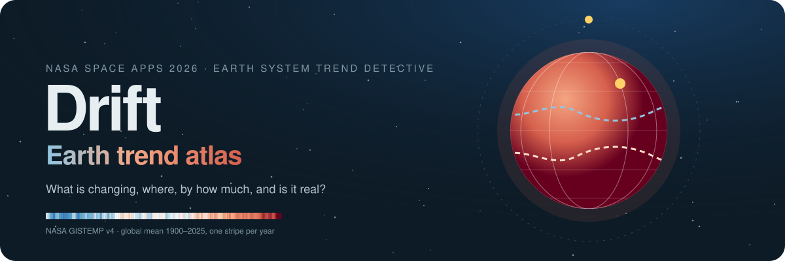
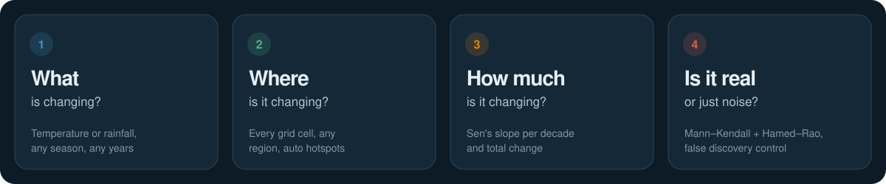
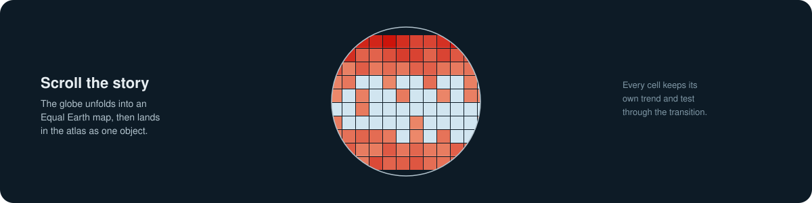
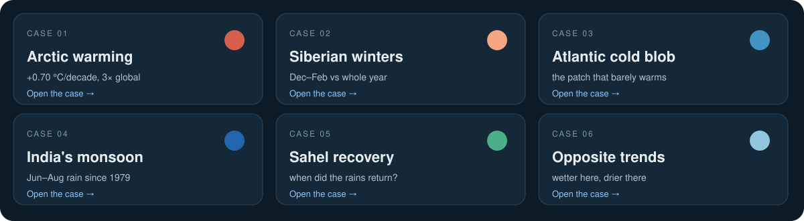
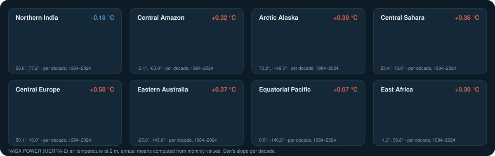
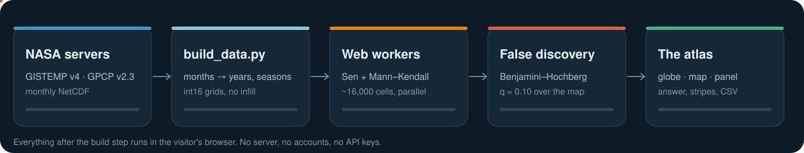
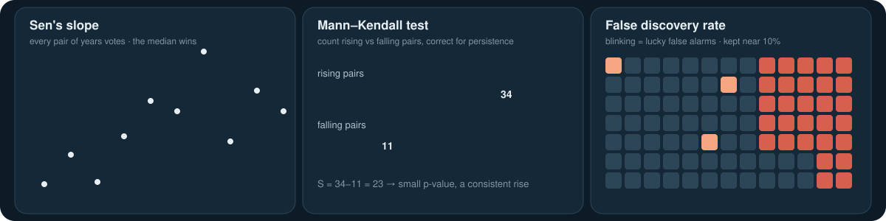
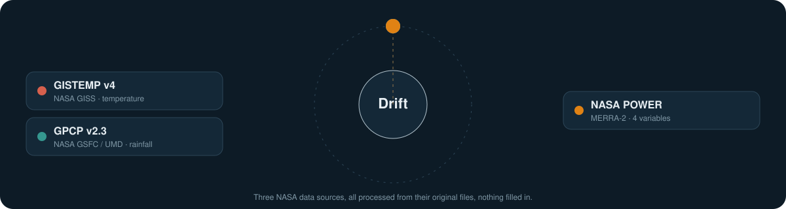

<div align="center">



### Find what is changing on Earth, where, by how much, and whether it is real.

[**Open Drift live**](https://priyanshusharan-cmd.github.io/drift-earth-atlas/) ·
[Demo slides](https://priyanshusharan-cmd.github.io/drift-earth-atlas/slides.html) ·
[30-second video](https://priyanshusharan-cmd.github.io/drift-earth-atlas/demo.html) ·
[Point lab](https://priyanshusharan-cmd.github.io/drift-earth-atlas/points.html) ·
[Field guide](https://priyanshusharan-cmd.github.io/drift-earth-atlas/learn.html)


</div>


## What Drift is

Drift is an interactive atlas of how Earth's climate is changing. Pick a NASA variable, a season and any window of years. Drift then computes a trend **and** a significance test for every one of about 16,000 grid cells on the planet, in your browser, in a second or two. It writes the answer in plain language and shows it on a spinning globe that unfolds into a map.

It was built for the [NASA Space Apps Challenge 2026](https://www.spaceappschallenge.org/2026/) challenge **Be an Earth System Trend Detective**, which asks for a tool that can select Earth science variables, visualise how they change over time, and determine what is changing, where, how much, and whether the change is significant.



## The record at a glance

Every stripe below is one year of NASA's global surface temperature record, computed from the same data files Drift ships with. Blue years were cooler than the 1951–1980 average; red years were warmer.



## Features



| | Feature | What it does |
|---|---|---|
| 🌍 | **Living globe** | The opening globe is painted with the live result. Drag to spin it; scroll and it unfolds into an Equal Earth map. |
| 🗺️ | **Trend atlas** | Every cell shows Sen's slope per decade. Cells without a statistically robust trend fade, so the real signal stands out. |
| 📍 | **Inspect any place** | Click a cell, drag a box or pick a hotspot. See the time series, the fitted trend with its 95% band, the year of the largest shift and a full statistics table. |
| ⏯️ | **Year by year** | Press play to watch each year's departure from the window mean. |
| 📡 | **Point lab** | Temperature, rainfall, humidity and wind from NASA POWER (MERRA-2) at eight places, with trend tests, a ranking, a map and CSV export. |
| 🕵️ | **Detective case files** | Six guided investigations open the live analysis on a real question, with a hint about what to look for. |
| 🧭 | **Guided tour** | A ten-step spotlight walks first-time visitors through every part of the atlas. |
| 📖 | **Field guide** | Twelve plain-language definitions (anomaly, Sen's slope, p-value, persistence, false discovery rate…), each with an animated diagram. |
| 🧪 | **Method explainer** | "How Drift reads a place" runs the four statistical steps on the place you selected. |
| ↔️ | **Opposite trends** | Connected regions of robust change in both directions, plus a latitude profile. A variable can rise in one region and fall in another. |
| 💾 | **Share and export** | The URL keeps the whole view. Any series downloads as CSV with its source and method in the header. |
| 🌗 | **Light and dark** | Both themes, keyboard accessible, and still layouts for reduced-motion settings. |

## Detective case files



| Case | Question | Data |
|---|---|---|
| 01 · Arctic warming | Is the Arctic really warming faster than the rest of the planet? | GISTEMP, annual, 1981–2025 |
| 02 · Siberian winters | Does Siberia warm more in Dec–Feb than across the whole year? | GISTEMP, Dec–Feb, 1981–2026 |
| 03 · Atlantic cold blob | Why is one patch of ocean south of Greenland barely warming? | GISTEMP, annual, 1900–2025 |
| 04 · India's monsoon | Has June–August rainfall over India changed since 1979? | GPCP, Jun–Aug, 1979–2025 |
| 05 · Sahel recovery | After the droughts of the 1970s and 80s, is the Sahel getting wetter? | GPCP, Jun–Aug, 1983–2025 |
| 06 · Opposite trends | Can rainfall rise in one part of the Pacific while falling in another? | GPCP, annual, 1979–2025 |

Each case is an ordinary Drift link, so the verdict always comes from the live calculation, never from pre-written text.

## Point lab: NASA POWER and MERRA-2



The [Point lab](https://priyanshusharan-cmd.github.io/drift-earth-atlas/points.html) adds two more variables the atlas doesn't have, relative humidity and wind speed, from NASA's [POWER](https://power.larc.nasa.gov/) service, which draws on the MERRA-2 reanalysis named in the challenge brief. Pick a variable, a season and a window. Drift computes day-weighted yearly means from the monthly values, tests every place, and controls false discoveries across all eight.

| Place | Why it's interesting |
|---|---|
| Northern India | Monsoon, aerosols and irrigation; one of the few places where air temperature is falling |
| Central Amazon | Rainforest rainfall and drought |
| Arctic Alaska | Arctic amplification |
| Central Sahara | The driest air on the list |
| Central Europe | The fastest-warming place in the set |
| Eastern Australia | Drought and flood swings |
| Equatorial Pacific | The heart of El Niño |
| East Africa | The "East African paradox" in long rains |

## How it works



`scripts/build_data.py` downloads NASA's original NetCDF files and averages months into years and seasons, weighted by the days in each month. It stores the result as compact int16 grids using GISTEMP's own 0.01 quantisation. **Nothing is interpolated or filled in.** A season needs all of its months; a year needs at least ten.

In the browser, a pool of web workers computes every cell's trend in parallel. The main thread then applies false discovery control across the whole map, finds connected hotspots, and writes the answer.

## The statistics



| Step | Method | Why | Reference |
|---|---|---|---|
| Trend | **Sen's slope**, the median of all pairwise slopes | Robust to outliers and single freak years | Sen (1968) |
| Significance | **Mann–Kendall** test with tie correction | Rank-based, no normality assumption | Mann (1945), Kendall (1975) |
| Persistence | Variance inflated from significant autocorrelations of detrended ranks | Neighbouring years are alike; ignoring it overstates certainty | Hamed & Rao (1998) |
| Slope interval | 95% interval from the ranked pairwise slopes | Shows the range of plausible rates | Gilbert (1987) |
| Field significance | **Benjamini–Hochberg** false discovery rate, q = 0.10 | Thousands of tests at once produce lucky false alarms | Benjamini & Hochberg (1995), Wilks (2016) |
| Change point | **Pettitt** test on a place or region | A step can masquerade as a trend | Pettitt (1979) |
| Regional means | cos(latitude) area weights; years under 80% coverage skipped | Fair averages over any box | |

`tests/stats.test.mjs` checks the JavaScript against `pymannkendall` and `scipy.stats.theilslopes` on reference series, including autocorrelated and heavily tied ones.

**Limits.** A robust trend means a change is unlikely to be noise. It does not explain the cause. Early GISTEMP decades rest on sparse stations, so cells with data in fewer than 70% of the selected years are left blank. Regions are latitude–longitude rectangles that include land and ocean alike.

## Data



| Variable | Product | Grid | Period |
|---|---|---|---|
| Surface temperature anomaly (°C vs 1951–1980) | [NASA GISS GISTEMP v4](https://data.giss.nasa.gov/gistemp/) | 2°, 1200 km smoothing | 1900–present |
| Air temperature, precipitation, relative humidity, wind speed at 8 points | [NASA POWER](https://power.larc.nasa.gov/) monthly point API (MERRA-2 and POWER sources, v2.10) | point | 1984–2024 |
| Precipitation (mm/day) | [GPCP v2.3 monthly](https://www.ncei.noaa.gov/products/climate-data-records/precipitation-gpcp-monthly) (NASA GSFC / UMD, via NOAA NCEI) | 2.5° | 1979–present |

To add a dataset, add an entry to `datasets.json` (a single NetCDF URL or a directory of monthly files) and run the build. The app reads the catalog and each dataset's `meta.json`, so new datasets appear without code changes.

## Run it locally

```sh
git clone https://github.com/priyanshusharan-cmd/drift-earth-atlas
cd drift-earth-atlas
npm run dev        # http://localhost:4173
npm test           # statistics tests
```

The processed data is already included, so the app needs no API keys, accounts or backend. To rebuild the data from NASA's servers (Python 3.10+):

```sh
python3 -m venv .venv && .venv/bin/pip install -r requirements.txt
npm run data                                   # all datasets
.venv/bin/python scripts/build_data.py gpcp --refresh
```

## Project layout

```text
web/index.html          the atlas
web/points.html         point lab: NASA POWER (MERRA-2) at eight places
web/learn.html          field guide: every term, with animated diagrams
web/about.html          the challenge, method, data and team
web/slides.html         seven-slide demo deck
web/js/main.js          state, rendering and interaction
web/js/worker.js        per-cell trends, run on a pool of workers
web/js/stats.js         Sen, Mann–Kendall (Hamed–Rao), Pettitt, FDR, regional means
web/js/map.js           canvas globe and Equal Earth map
web/js/points.js        point lab analysis and charts
web/js/cases.js         detective case files
web/js/tour.js          guided tour
web/data/               built NASA grids and world geometry
scripts/build_data.py   NASA download → yearly and seasonal int16 grids
tests/                  statistics tests and reference values
docs/                   demo video, slides PDF and README graphics
```

## Credits

**Data:** GISTEMP Team (NASA GISS); GPCP (Adler et al., 2018); NASA POWER Project (NASA Langley Research Center), using MERRA-2 (NASA GMAO). **Libraries and assets:** D3 and TopoJSON (ISC, Mike Bostock); Natural Earth via world-atlas (public domain); ColorBrewer palettes (Cynthia Brewer); Geologica typeface (SIL OFL).

**Use of AI:** AI coding assistants helped write parts of the code and documentation. All scientific values come from NASA data, and the statistics are checked against independent reference libraries in the test suite.

**Built by** [Priyanshu Sharan](https://github.com/priyanshusharan-cmd), BMS College of Engineering, Bengaluru, for the NASA Space Apps Challenge 2026. Drift is not endorsed by NASA.


